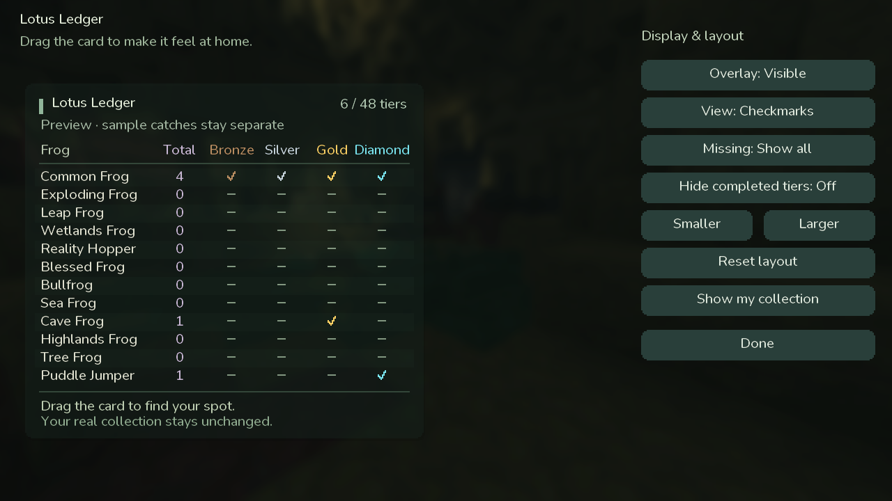
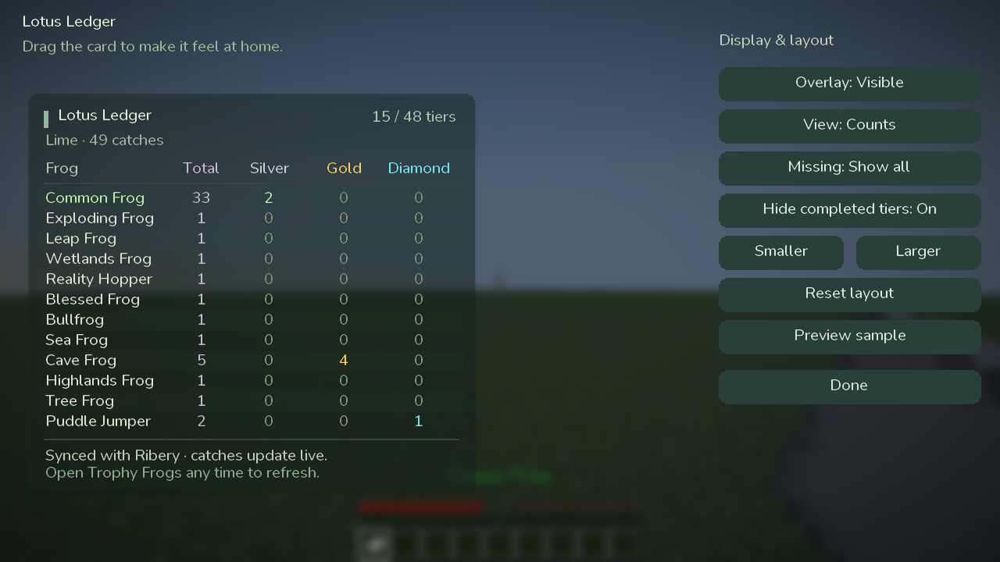

# Lotus Ledger

A standalone Trophy Frog collection overlay for **Hypixel SkyBlock's Lotus Atoll**.

**[Download 1.2.0](https://github.com/SleepCodeX/lotus-ledger/releases/tag/1.2.0) · Minecraft 26.2 · Fabric Loader 0.19.5+ · Java 25**

## Install and get started

1. Use Minecraft **26.2**, Java **25**, Fabric Loader **0.19.5+**, and **Fabric API 0.161.0+26.2** or a newer build for Minecraft 26.2.
2. Put **lotus-ledger-1.2.0.jar** in your instance's **mods** folder. Remove older **Lotus Ledger** jars.
3. Join Hypixel SkyBlock. Enable **Profile** and **Area** in **/widget**, and enable Player List Info if it is hidden.
4. Visit **Researcher Ribery** on Lotus Atoll and open **Trophy Frogs**. Give the menu a moment to load your collection.
5. Fish normally. Incoming trophy frog catch messages immediately update the HUD and saved progress.

**This is a separate mod that runs alongside SkyHanni and Trevor Roll. Keep your SkyHanni jar installed.** It has its own mod ID, settings, commands and save file, and does not require Fabric Language Kotlin.

## Your collection, at a glance

By default, all **12 species × four tiers** appear in a compact movable table. A see-through background at 44% opacity, a soft shadow and rounded type keep the world visible behind the card.

- **Top right:** collected tier combinations out of **48**.
- **Total column:** catches of that species across all four tiers.
- **Bronze / Silver / Gold / Diamond:** checkmarks or catch counts.
- **Below the title:** your profile and the combined catch total.
- New catches highlight the matching row for five seconds.

**/lotusledger** opens the layout and settings editor. Drag the card to move it. Switch views, filter a missing tier, adjust scale, or reset the layout. **/lotusledger toggle** hides the HUD while tracking continues. **/lotusledger preview** shows sample data separately from your real collection.

## Hide completed tiers

Open **/lotusledger** and turn **Hide completed tiers** on. A column disappears once all 12 species are collected in that tier. For example, collecting every Bronze frog hides Bronze while Silver, Gold and Diamond remain visible.

The option starts off and is saved between sessions. Hidden tiers still count toward species totals, the grand total and collection progress. Completion uses the entire current profile, even when the missing-tier row filter is active. Unknown tiers stay visible. A later collector-menu correction can bring a tier back. Turning the option off restores all columns. If all four tiers are complete, the card shows **All tiers collected** and keeps species totals.

## Menu sync, every time

Every opening of Ribery's **Trophy Frogs** menu starts a fresh reconciliation. Complete recognized entries replace their saved values with the menu's values, including downward corrections. Menu amounts are never added to existing amounts.

Repeated unchanged menu openings are idempotent. If an incoming catch arrives while an older menu snapshot is still being read, the newer catch is preserved; reopening the menu or receiving a fresh stable menu snapshot finishes reconciliation. Subsequent chat catches increment from the reconciled baseline.

A partial or unrecognized tooltip is left untouched. A checkmark without a numeric quantity confirms collection but does not invent a catch count.

Until a baseline is available, the HUD tells you to visit **Researcher Ribery → Trophy Frogs**. **?** means unknown; it is never shown as a confirmed zero. **≥** means the displayed value is a lower bound. Confirmed missing tiers display a dash in checkmark view and zero in counts view.

## Automatic chat tracking

The mod reads incoming trophy frog **system messages**, with Minecraft formatting removed. It handles current messages without an article, **a**, and **an**. Ordinary player chat, quoted catch text, other players' RIBBIT announcements, item pickups and sack withdrawals do not create catches. The same message reaching Fabric's allow and cancellation callbacks is counted only once; two genuinely distinct identical catch messages still count twice.

## Persistence and performance

Progress is separated by Minecraft player UUID, Hypixel main/alpha network, and the SkyBlock profile name provided by Hypixel. Enable the Profile widget before fishing. Catches received before the profile is identified are buffered for that world; they cannot safely be assigned after changing worlds.

Data lives in **config/lotus-ledger.json**. Catches and imported corrections save immediately. Writes use atomic replacement where supported, retain a last-good backup, and preserve damaged input during recovery.

Menu scanning runs only while the relevant menu is open, four times per second. Unchanged item components reuse parsed results. The HUD reuses prepared text until data or options change; rendering does not scan inventories, parse messages, format counters, or write files.

## Build and validation

Use JDK 25 and run **./gradlew build**. The installable jar is **build/libs/lotus-ledger-1.2.0.jar**. The font asset is already bundled; normal builds do not need Python.

The release contains the exact jar that passed the local build, logic, persistence and real Minecraft client checks. GitHub also verifies the source in an independent build and offline client job. The preview above was captured in that offline client with controlled sample data, not a live Hypixel session.

See [VALIDATION.md](VALIDATION.md) for the exact checks and limits, and [THIRD_PARTY_NOTICES.md](THIRD_PARTY_NOTICES.md) for the game-format evidence and font license. The implementation is MIT licensed; the bundled rounded font retains its SIL Open Font License.

